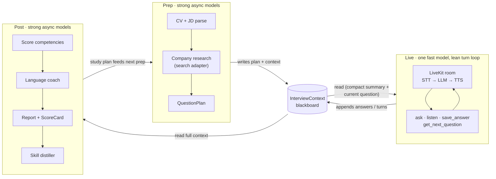

# Architecture

A concise tour of how OpenInterview is put together. The codebase retains
upstream work-package labels in comments, but this document describes the
current implementation.

OpenInterview is a community fork of DeepInterview: it reads a candidate's CV +
a job description, researches the target company, runs an adaptive real-time
voice interview with a stylized avatar, scores it, then routes the user into a
study coach that teaches weak areas — a closed prep ⇄ interview ⇄ feedback
loop. English-first, multilingual, Apache-2.0.

## The prep / live / post split

The single most important design decision: **heavy reasoning happens before and
after the call, never on the live turn path.** A voice turn must feel instant,
so the live loop runs exactly one lean fast model against a precomputed plan and
does no blocking I/O on the critical path.

| Phase    | When                | Models                                   | Job |
| -------- | ------------------- | ---------------------------------------- | --- |
| **Prep** | before the call     | strong async models (LangGraph pipeline) | Parse CV + JD, research the company, build the `InterviewContext` blackboard and a `QuestionPlan`. |
| **Live** | during the call     | one fast model on the turn path          | Ask the planned questions, listen, record answers/turns. No web search, no scoring, no DB reads mid-turn. |
| **Post** | after the call      | strong async models (LangGraph pipeline) | Score competencies, language-coach, write the report; distill reusable skills. |



<details>
<summary>ASCII fallback (same flow)</summary>

```
   PREP (strong async)         LIVE (one fast model)          POST (strong async)
 ┌───────────────────┐       ┌──────────────────────┐       ┌────────────────────┐
 │ CV+JD parse        │       │ LiveKit room          │       │ score competencies  │
 │ company research   │       │ STT → LLM → TTS        │       │ language coach      │
 │ → QuestionPlan     │       │ ask·listen·save_answer │       │ → report + ScoreCard│
 └─────────┬──────────┘       │ get_next_question      │       │ → skill distiller   │
           │ writes           └──────────┬─────────────┘       └─────────┬──────────┘
           ▼                             │ appends                       │ reads
        ┌───────────────────────  InterviewContext (blackboard)  ───────────────────┐
        │  written in prep   ·   read + appended in live   ·   read in post           │
        └───────────────────────────────────────────────────────────────────────────┘
           ▲                                                              │
           └──────────────  study plan loops back into next prep  ◄───────┘
```

</details>

## The `InterviewContext` blackboard

`InterviewContext` is the shared contract every phase reads or writes — the
"blackboard" that ties prep → live → post together. It is defined once in
[`packages/shared`](../packages/shared) (TypeScript) and mirrored as Pydantic in
the agent (`apps/agent/.../shared_models.py`), with a parity test
(`apps/agent/tests/test_parity.py`) and round-trip fixtures keeping the two in
sync.

- **Prep writes it.** The LangGraph prep pipeline produces the candidate
  summary, company intel, job spec, and the `QuestionPlan`.
- **Live reads + appends it.** The interviewer injects only a *compact* slice
  (candidate summary + current question + last turns) into the fast model's
  prompt, and appends `AnswerRecord`s and transcript turns as the conversation
  proceeds (`live/state.py`, via the `save_answer` / `get_next_question`
  function tools).
- **Post reads it.** Scoring, language coaching, and the report read the full
  context; the report screen loads the persisted `sessions.context` +
  `sessions.scorecard` rows (falling back to sample data offline so the report
  always renders).

Keeping the live prompt small (golden rule 2) is what keeps the turn path fast.

## Persistence and session history

`get_repository()` chooses one store in this order:

1. **Supabase** when both `SUPABASE_URL` and `SUPABASE_SERVICE_ROLE_KEY` are set.
2. **SQLite** when Supabase is not fully configured and `SQLITE_PATH` is set.
3. **Memory** otherwise; sessions disappear when the process restarts.

The SQLite store is local-only, single-user persistence. It stores one JSON row
per session in WAL mode and opens a fresh connection for each operation, so the
API and LiveKit workers see each other's writes without a process-local cache.
`GET /api/sessions` returns lightweight recent-session summaries and
`GET /api/sessions/library` returns deduplicated saved CVs and job descriptions.
Both endpoints return 404 when Supabase is configured. The web UI merges the
SQLite list with browser-local history and links each interview to redo, report,
Prep Coach, and spoken Socratic Coach routes.

## The provider-adapter pattern (mock-first)

Every external provider sits behind a narrow interface, so the core logic never
imports a vendor SDK directly. Adapters live in
[`apps/agent/src/deepinterview_agent/core/adapters/`](../apps/agent/src/deepinterview_agent/core/adapters):
`base.py` defines `Protocol`s (LLM, Search, Embeddings; the knowledge backend
has its own interface), and `mock.py` provides deterministic implementations.

The default wiring is **mock-first and offline**: the full prep → live → post
loop runs with **no API keys at all**, which is what CI and local development use.
Swapping in a real provider (Gemini/GPT for the LLM, Deepgram/Soniox for STT,
Cartesia/ElevenLabs for TTS, Tavily for search, bge-m3 for embeddings) means
adding one adapter behind the existing interface — not touching call sites. The
web side mirrors this with billing/storage/knowledge helpers that degrade to a
safe offline path when their env vars are unset.

## Live voice workers and turn handling

Two LiveKit workers share the same STT/LLM/TTS factories, context loader, and
turn-handling configuration:

- **Interviewer** — `deepinterview_agent.worker`, dispatched through
  `LIVEKIT_AGENT_NAME` (default `deepinterview-interviewer`).
- **Spoken Socratic coach** — `deepinterview_agent.worker_coach`, dispatched
  through `LIVEKIT_COACH_AGENT_NAME` (default `deepinterview-coach`). It loads
  the finished interview's `InterviewContext`, coaches the weak areas without a
  retrieval tool, and saves `coach_transcript` separately from the interview
  transcript.

Both require the `livekit` extra and live provider keys. The interviewer
pre-imports the optional multilingual turn-detector plugin before starting its
worker process; the coach currently reuses the same turn-handling builder but
does not prewarm it.

Turn handling requires three transcribed words before an interruption and uses
a 1–6 second silence window for thinking pauses. Supported languages also load
the multilingual semantic end-of-turn model; unsupported languages such as
Vietnamese fall back to the widened silence window.

## Package map

```
openinterview/
├── apps/
│   ├── web/                 # Next.js 16 (App Router) + React 19 + Tailwind v4 + shadcn/ui
│   │   ├── app/api/         # coach/chat · health · kb/query · session/[id] · sessions · upload
│   │   ├── app/{setup,interview,report,prep,...}/   # screens incl. /interview/coach
│   │   ├── components/      # interview · report · prep · avatar · ui
│   │   └── lib/             # i18n · session · supabase · livekit · r2 · kb
│   └── agent/               # Python 3.11+ LiveKit worker + LangGraph pipelines
│       └── src/deepinterview_agent/
│           ├── api/         # FastAPI routers: /api/prep, /api/score, /api/sessions
│           ├── prep/        # LangGraph prep pipeline (graph · nodes · prompts · state)
│           ├── live/        # LiveKit interviewer · director · handoffs · state · kb_tool
│           ├── post/        # evaluator · language_coach · report
│           ├── core/        # adapters · config · deps · persistence · observability
│           └── skilllib/    # skill distiller · scrub · promote · store
├── packages/shared/         # TS ↔ Pydantic contracts (InterviewContext, QuestionPlan, …) + JSON schema
├── services/lightrag/       # knowledge sidecar (FastAPI, :9621) — /kb/ingest, /kb/query
├── cli/                     # developer/operator CLI
├── skills/                  # versioned company playbooks + rubrics (Markdown + YAML)
└── docs/                    # these architecture + deploy docs
```

`packages/shared` is built **first** (WP-0): nothing else compiles until those
contracts round-trip JSON between web and agent.

## REST and room contracts

Three processes expose HTTP. Paths below are the real route definitions in the
code, not shorthand.

| Endpoint                     | Method | Served by                          | Purpose |
| ---------------------------- | ------ | ---------------------------------- | --- |
| `/api/prep`                  | POST   | **agent** FastAPI (`apps/agent`)   | Run the prep pipeline → `InterviewContext` + `QuestionPlan`. |
| `/api/score`                 | POST   | **agent** FastAPI (`apps/agent`)   | Run the scoring/post pipeline → `ScoreCard`. |
| `/health`                    | GET    | **agent** FastAPI (`apps/agent`)   | Liveness check (`{"ok": true}`). |
| `/api/session/[id]`          | GET    | **agent** FastAPI (`apps/agent`)   | Read a session view (context/scorecard/transcript). |
| `/api/session/[id]/inputs`   | GET    | **agent** FastAPI (`apps/agent`)   | Load saved CV/JD/company/language inputs for a redo. |
| `/api/sessions`              | GET    | **agent** FastAPI (`apps/agent`)   | Recent-session summaries; local SQLite only, otherwise 404. |
| `/api/sessions/library`      | GET    | **agent** FastAPI (`apps/agent`)   | Deduplicated saved CVs + JDs; local SQLite only, otherwise 404. |
| `/api/upload`                | POST   | **web** (`apps/web`)               | CV upload (server-side parse) → forwards to prep. |
| `/api/coach/chat`            | POST   | **web** (`apps/web`)               | Prep-coach chat proxy. |
| `/api/kb/query`              | POST   | **web** (`apps/web`)               | Proxy to the lightrag sidecar's `/kb/query` via `LIGHTRAG_URL`. |
| `/kb/ingest`                 | POST   | **lightrag** sidecar (`:9621`)     | Ingest documents into a per-user knowledge store. |
| `/kb/query`                  | POST   | **lightrag** sidecar (`:9621`)     | Retrieve a grounded answer + citations for a query. |

(The web app proxies session, coach, upload, and knowledge routes; the LiveKit
access token is minted by a server action (`createInterviewToken` in
`apps/web/lib/livekit.ts`), not an `/api/token` route. The lightrag port is
configurable via `LIGHTRAG_PORT`, default `9621`.)

**Room contract (live voice).** The browser gets a scoped token with an explicit
`roomConfig.agents` dispatch. Interview rooms request `LIVEKIT_AGENT_NAME`;
Socratic rooms request `LIVEKIT_COACH_AGENT_NAME` and include `mode: "socratic"`
in dispatch metadata. The room name is the session id, so each worker can load
the same persisted `InterviewContext`.

The interviewer drives the conversation through `save_answer` and
`get_next_question`. The coach has no tools: it speaks from the weak-area summary
and captures its own transcript. Both use the cascaded STT → LLM → TTS path and
the shared turn-handling rules above.

---

For depth on any of the above — the LangGraph node graphs, avatar/Veo prompts,
scoring rubrics, and the per-WP interface contracts — read the code in the
package each concerns (`apps/agent/src/deepinterview_agent/{prep,post,live}`,
`scripts/veo`, `skills/`) and the contracts in `packages/shared`.
